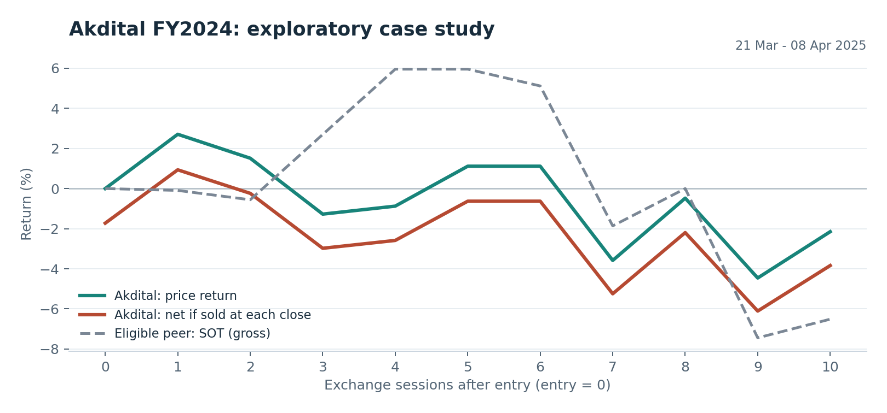

# Casablanca Earnings Lab

**An auditable Python study of earnings announcements, trading costs and portfolio risk.**

Can a positive earnings surprise predict a useful short-term return in the Casablanca market? This project builds the data checks and simulation needed to test that question. The initial research snapshot **did not establish a deployable alpha**: no fully verified qualifying signal survived the evidence checks. One separately labeled exploratory case lost 3.84% after modeled costs.

**Start here:** [Research case study](docs/case_study.md) · [Architecture](docs/architecture.md) · [Original research report](docs/research_report.pdf) · [Run the demo](#run-the-offline-demo)



## What this demonstrates

| Research problem | Implementation / evidence |
| --- | --- |
| Expectations must exist before results | Match issuer, fiscal period, accounting measure, currency and unit; reject same-day/future forecasts when times are unknown |
| A later revision can erase an apparent surprise | Select the latest collected comparable prior estimate; retain known unresolved revisions as explicit exclusions |
| Gross gains may disappear after trading | Apply fees and slippage on both sides; report delayed-entry and double-cost diagnostics |
| A quoted price is not necessarily an available exit | Enforce participation limits, entry expiry and persistent exit queues |
| A successful example is not statistical evidence | Separate exploratory cases from verified signals; preserve missing/censored outcomes and fail the deployment gate |
| A reviewer needs to inspect decisions | Save source IDs, exclusion reasons, cash/share ledgers, remaining inventory and input hashes |

## Research snapshot

Research date: **10 November 2026**. Price archive cutoff: **9 November 2026**.

| Measure | Recorded result |
| --- | ---: |
| Stock histories in the local research archive | 64 |
| Collected annual releases / issuers | 15 / 8 |
| Forecast records | 21 |
| Direct source downloads | 28 successful / 35 attempted |
| Fully verified qualifying signals | **0** |
| Exploratory Akdital FY2024 event, 10 sessions, net | **-3.84%** |
| Same event with entry one session later, net | **-8.28%** |
| Deployment decision | **No allocation to the new sleeve** |

The Akdital forecast is management-plan-derived and its comparability is unresolved. These are descriptive price-return results, not a profitable live track record. Incomplete forecast revisions, corporate actions, historical constituents and peer-event coverage limit the study. The price period was previously inspected, so it is not an untouched test sample.

Read the [case study](docs/case_study.md) for the hypothesis, results and limitations. Source-linked inputs are in [data/earnings](data/earnings). Frozen v7 evidence is in [docs/evidence](docs/evidence); its manifest identifies the original snapshot and is not a checksum of this reformatted portfolio edition.

## Run the offline demo

The demo uses **six fictional issuers and synthetic prices**. It exercises the real matching, event-study and portfolio code without downloading market data. Its returns are not evidence about Casablanca or any investment strategy.

Python 3.12 is the tested runtime. On Windows, extract this project and double-click **RUN_DEMO.bat**, or run these commands separately:

```powershell
python -m venv .venv
.\.venv\Scripts\python.exe -m pip install -r requirements.txt
.\.venv\Scripts\python.exe -m unittest discover -s tests -v
.\.venv\Scripts\python.exe run_demo.py
```

On macOS/Linux, replace `.venv\Scripts\python.exe` with `.venv/bin/python`.

Open **outputs/demo/report.html**. Inspect the event audit, cash ledger, trade fills, unfilled exits and remaining inventory beside it. The examples include a superseded estimate, a mismatched profit definition, a forecast published too late, a scope uncertainty and an unfinished holding period.

## Validation

The portfolio edition contains **72 tests**: 23 earnings-engine tests, 2 public-demo integration tests and 47 regression tests inherited from the earlier price/momentum infrastructure. The suite covers forecast timing, exact fee accounting, ten-session exits, missing liquidity, delayed risk exits, corporate actions, cash conservation and future-data independence.

Local test results and the execution environment are recorded in [docs/validation.md](docs/validation.md). A [GitHub Actions workflow](.github/workflows/tests.yml) is configured for Python 3.12 on Linux and Windows; a hosted run is not claimed until it actually executes on GitHub.

For development checks:

```text
python -m pip install -r requirements-dev.txt
python -m ruff check .
python -m ruff format --check .
python -m unittest discover -s tests -v
```

## Reproduce the real-market study

The public package contains curated event/forecast facts, source references and derived results. Full third-party PDFs and the raw price archive are kept outside this distribution.

To rerun the historical study, supply the original 64 exchange-export CSVs under `data/prices/`, then run `python run_research.py`. The archive used in the initial investigation is preserved separately in the original v7 research bundle. For a different data vintage, record that change and do not present it as an exact replication.

`python collect_sources.py --limit 35 --timeout 12` optionally downloads registered public documents and logs successes, errors and hashes. It does not automatically approve PDF numbers as accounting facts; source dates, units and comparability still require review. See [data documentation](docs/data.md).

## Project map

| Location | Purpose |
| --- | --- |
| `casa_alpha/events.py` | Forecast matching, event windows, peers and evidence gates |
| `casa_alpha/portfolio.py` | Cash, whole shares, limits, queued exits and drawdown response |
| `casa_alpha/config.py` | Explicit research parameters |
| `casa_momentum/` | Inherited price/data infrastructure and regression-tested earlier modules |
| `run_demo.py` | Deterministic public demonstration using the research engine |
| `run_research.py` | Original real-market study runner; requires local price files |
| `research/` | Frozen protocol and implementation decisions |
| `tests/` | Unit and integration checks |
| `docs/` | Case study, architecture, data notes and interview preparation |

## Development provenance

This is an ** software project**. Public documents were collected and manually reviewed; coding, debugging and documentation. The original v6 infrastructure is retained with its history identified in the documentation. Test evidence supports specific software behavior, not a claim of independent human authorship or investment profitability.

The next research milestone is a broader, correctly dated and comparable event panel. The next engineering milestone is stronger independent validation of ingestion and execution assumptions. See [the roadmap](docs/roadmap.md).

For portfolio publication, see the [publishing checklist](docs/publishing.md),
[application drafts](docs/career_assets.md) and [interview guide](docs/interview_guide.md).
