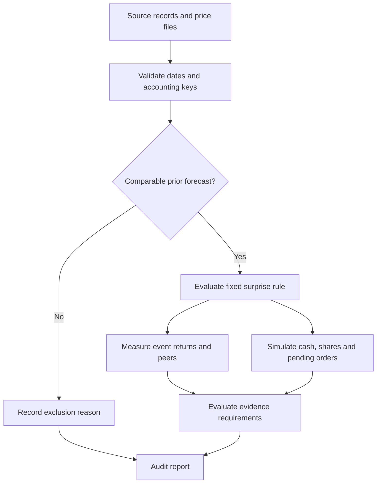

# Architecture and decisions

The event engine is separate from data collection, portfolio accounting and reporting. A reviewer can inspect the reason for a rejected record without running a broker or a web server.

## Where to start reading

| Function | Question it answers |
| --- | --- |
| `match_forecast` | Which comparable estimate existed before the event, and what remains unverified? |
| `liquidity_at` | Was the stock sufficiently tradable using information through publication? |
| `trade_window` | When could an entry and the scheduled exit occur? |
| `peer_comparison` | How did other eligible stocks move over that interval? |
| `simulate` | How much cash and how many shares remain after every fill, cost and queued exit? |
| `evaluate_gate` | Does the evidence meet the declared requirements? |

## Timing

An unknown release time is treated as end of day. No same-day entry is allowed. The holding interval starts at the actual simulated entry. A ten-session exit has index `entry + 10`, not ten calendar days or ten inclusive observations.

The portfolio decides desired quantities from the previous close and NAV. Realized daily volume is used only to limit simulated fills; it is not claimed as information available before the order. A risk trigger at the close queues action for the next session.

## Accounting

Buy cash outflow includes slippage and fees. Sell cash inflow is net of both. Cost basis is reduced proportionally for a partial sale. Positions remain in inventory while an exit lacks trading capacity; missing execution never becomes a convenient cash balance.

Known splits change quantity while preserving economic value. Complete corporate-action coverage is still absent from the real-market panel. The included test covers the accounting mechanism, not the completeness of the source data.

## Reproducibility boundaries

The public demo is deterministic and synthetic. It uses the same event and accounting functions as the real study. Real-market reruns need the local price archive. The original historical result files and manifest are preserved as a dated snapshot, while this edition adds formatting, demonstration and presentation files.

The inherited `casa_momentum` modules support price ingestion and earlier regression tests. They are not advertised as a second newly validated alpha. No broker connector, live order sender, Docker deployment or hosted CI result is claimed in this edition.
